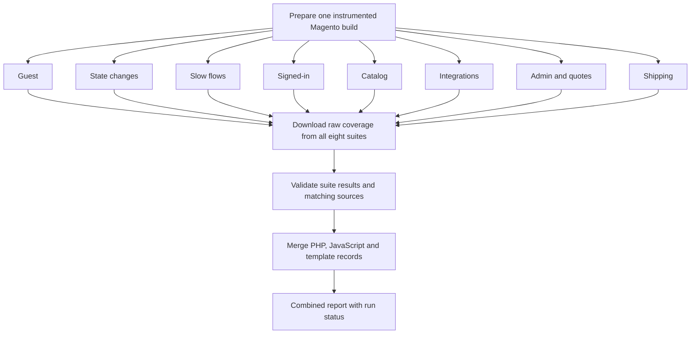

<!--
SPDX-FileCopyrightText: Private Entrepreneur Vitalii Boiko
SPDX-License-Identifier: Elastic-2.0
License: see LICENSE in the repository root.
-->

# Real-world E2E coverage for hundreds or thousands of tests

When a Magento suite grows to hundreds or thousands of end-to-end tests, running everything on one runner makes feedback slow. Checkout, account, catalog, Admin and integration scenarios all add browser time. Coverage needs those scenarios, but it does not need them to execute sequentially on one machine.

We split the tests into independent CI jobs, collect coverage in each job, then merge their execution records into one report. This article adapts a real Magento project's Cypress CI setup, with names and application details generalized. It uses two shards for guest smoke tests and eight suites for the full coverage run.

This is a project CI example. MageLens's `./bin/run-coverage` runs the full configured suite in one workspace; it does not provide a distributed `--shard` or cross-run merge command. The orchestration below belongs in your application's CI, with collectors and merge validation adapted to its configuration.

## Why split the suite?

A shard is a subset of the test suite assigned to one runner. With one shard, the browser executes every selected scenario in sequence. With several shards, independent groups execute at the same time.

For illustration, 1,000 tests averaging 12 seconds each take about 200 minutes of test execution on one runner. Eight evenly balanced shards would each need about 25 minutes, plus build, environment startup and reporting time. These numbers illustrate the calculation; they are not measured timings from the example project. Actual elapsed time depends on the slowest shard and available runner capacity.

The approximate relationship is:

```text
single runner = build + setup + all tests + report
parallel run = shared build + slowest(setup + shard tests) + merge/report
```

Parallelism reduces waiting time, while using more machines and repeating some setup work. Balance shards using observed durations rather than test counts alone: an integration test waiting for an external sandbox can take much longer than a catalog assertion.

## Smoke tests for feedback, a full suite for coverage

The example has two separate workflows:

| Workflow | When it runs | Test selection | Coverage purpose |
| --- | --- | --- | --- |
| Guest smoke | Pull requests into development branches | Two shards: guest catalog and the remaining guest scenarios | Fast feedback; coverage instrumentation is off |
| Full E2E | Pull requests into the release branch | Eight suites covering the broader application | Collect and merge PHP, JavaScript and template coverage |

The smoke suite is a selected set of guest journeys, rather than a random fraction of all tests. It gives developers useful feedback without waiting for the slower account, Admin and integration scenarios. Each job also checks that the application responds before launching Cypress; that readiness check is separate from the browser smoke suite.

Here is the smoke selection, adapted from the workflow. The second shard explicitly excludes the first shard's files so the guest catalog suite does not run twice:

```yaml
strategy:
  fail-fast: false
  matrix:
    include:
      - shard: catalog
        spec: cypress/e2e/guest/catalog/**/*.cy.js
      - shard: other
        spec: cypress/e2e/guest/**/*.cy.js
        exclude: cypress/e2e/guest/catalog/**/*.cy.js
```

Pass `spec` to Cypress's `--spec` option and, when set, `exclude` through `--config excludeSpecPattern=...`. These are workflow fragments; application setup and the Cypress invocation are omitted.

Smoke success means the selected smoke scenarios passed. It does not establish full-suite success or full-suite coverage. The full workflow includes guest scenarios again, so its report is self-contained and does not depend on coverage from an earlier smoke run.

## Build once, run eight isolated suites

The full workflow prepares one Magento build with locked dependencies, generated files, browser dependencies and instrumented static assets. Every shard and the report job restore that same build for the same checked-out commit. This saves repeated build work and gives the coverage collectors matching source and instrumentation maps.

The eight suite names and paths below are generalized. This job fragment shows the split and Cypress invocation; the preceding steps that restore the shared build, start services and configure the coverage collectors are omitted. Run Cypress from the test workspace where its dependencies and coverage support are installed.

```yaml
strategy:
  fail-fast: false
  matrix:
    include:
      - suite: guest
        spec: cypress/e2e/guest/**/*.cy.js
      - suite: state-changes
        spec: cypress/e2e/state-changes/**/*.cy.js
      - suite: slow
        spec: cypress/e2e/slow/**/*.cy.js
      - suite: signed-in
        spec: cypress/e2e/signed-in/**/*.cy.js
      - suite: catalog
        spec: cypress/e2e/catalog/**/*.cy.js
      - suite: integrations
        spec: cypress/e2e/integrations/**/*.cy.js
      - suite: admin-quotes
        spec: cypress/e2e/quotes/**/*.cy.js,cypress/e2e/admin/**/*.cy.js
      - suite: shipping
        spec: cypress/e2e/shipping/**/*.cy.js
steps:
  # Build restoration, environment and coverage setup go here.
  - name: Run selected suite
    run: >-
      ./node_modules/.bin/cypress run --browser chrome
      --spec "${{ matrix.spec }}"
```

CI schedules one job for each matrix entry; each browser receives only that entry's spec selection. The CI matrix supplies the parallelism, so this form of splitting does not require Cypress Cloud scheduling. Maintain a complete, non-overlapping spec inventory as tests are added or moved.



Each shard has its own Magento services and database restored from a CI snapshot. A separate database prevents one shard's configuration changes, cart operations or fixture cleanup from affecting another. External systems also need isolation: use shard-specific search indexes and fixture identities, or serialize jobs that reuse the same mutable sandbox resources. Separate local databases alone cannot isolate an external service.

Use `fail-fast: false` to let the remaining shards finish when one fails. This preserves failure evidence and coverage from the other suites; it does not make the overall run successful. Keep state-changing tests in an isolated group, and keep dependent operations together when dividing files.

For multiple environments on one host, give each checkout its own Docker project, domain and ports. Never run concurrent coverage commands against one MageLens workspace: preparation replaces previous outputs and the workflow lock protects that shared state.

## What each shard uploads

The useful merge inputs are raw execution records, their matching manifests, and test results. Per-shard HTML reports alone cannot reconstruct the combined coverage.

The example uploads one artifact per suite, including on failure. A generalized layout is:

```text
coverage-input/
  coverage-raw-guest/
    metadata.json
    test-results.json
    php/native/                 # PCOV state, manifest and execution records
    js/                         # Istanbul coverage maps
    templates/manifest.json
    templates/hits/             # Template execution and DOM observations
  coverage-raw-catalog/
    ...
  ...                           # All eight expected suites
```

Metadata identifies the suite, selected specs, checked-out commit and Cypress outcome. For your own pipeline, also record the workflow run and attempt so a retry cannot accidentally reuse an older artifact. Keep the expected suite list explicit; finding seven artifacts is not success when eight were scheduled.

This GitHub Actions step uploads the artifact after each shard has staged its files:

```yaml
# Inside the matrix job, after collection:
- name: Upload raw coverage
  if: always()
  uses: actions/upload-artifact@v4
  with:
    name: coverage-raw-${{ matrix.suite }}
    path: coverage/raw/${{ matrix.suite }}
    if-no-files-found: error
```

The separate report job depends on the entire test matrix. Its job-level condition allows it to collect failure diagnostics when a shard fails. Here `prepare` is the shared build job and `e2e` is the matrix job:

```yaml
coverage-report:
  needs: [prepare, e2e]
  if: ${{ always() && needs.prepare.result == 'success' }}
  runs-on: ubuntu-24.04
  steps:
    # Restore the same commit, build and reporting tools here.
    - name: Download all shard coverage
      uses: actions/download-artifact@v4
      with:
        pattern: coverage-raw-*
        path: coverage-input
    # Validate, merge and render the records here.
```

Keep each downloaded artifact in its own directory. Multiple shards commonly produce files named `out.json` or `current.json`; extracting them into one flat directory can overwrite records. If staging JavaScript inputs into one directory, prefix filenames with the suite name or another unique identifier.

Use a fresh artifact directory for every run. Dependency caches and reusable zero-hit manifests can save preparation time; old execution hits must never become inputs to a new coverage report. Start collection after readiness checks and warm-up, and keep those activities out of the measured test execution.

## Merge execution records before calculating percentages

Coverage describes which source locations executed across the selected suite. The combined result is the union of those locations over one common source inventory.

Suppose a file has 100 executable lines. One shard executes lines 1–40; another executes lines 31–70. Their individual coverage is 40% each. Together they cover 70 distinct lines, so the merged coverage is **70%**. Averaging the two percentages gives 40%; adding them gives 80%. Both are wrong.

Apply that principle separately to each collector:

| Collector | Merge input | Combined meaning |
| --- | --- | --- |
| PHP | Native PCOV records and the matching executable-line manifest | A line is covered if any accepted record reports it executed |
| JavaScript | Istanbul statement, function and branch maps and counters | Merge counters for the same instrumented source locations |
| Templates | Matching template manifest and execution/DOM records | Merge template execution counters and presence observations, keeping the metrics separate |

The source inventory must also include eligible files that no shard visited. Otherwise the denominator shrinks to the files that happened to load and the percentage overstates coverage. A zero-hit baseline preserves those unvisited files.

### JavaScript: merge Istanbul maps, then render once

The example's report job stages the shards' raw JSON maps with unique filenames, adds a zero-hit baseline for the same build, then uses `nyc merge` and `nyc report`.

After validating and staging those inputs, the reporting commands look like this. Run them in the CI reporting environment with the project's locked `nyc` dependency, matching source tree and coverage include/exclude configuration:

```bash
mkdir -p coverage-merge/merged
./node_modules/.bin/nyc merge \
  coverage-merge/js-input coverage-merge/merged/coverage.json
./node_modules/.bin/nyc report \
  --temp-dir coverage-merge/merged \
  --report-dir coverage/js \
  --reporter html --reporter json-summary --reporter lcovonly
```

`coverage-merge/js-input/` contains only validated Istanbul maps, including the baseline. `coverage-merge/merged/` starts empty and receives the single merged map; the reporter reads that directory. Keep the merged output outside the input directory so later merges cannot count it again.

Before merging, verify that source paths, source hashes and statement/function/branch maps match the build. Use the same application path inside each container, or normalize paths to one source root with validation. Changing JSON filenames prevents overwrites; it does not normalize paths inside the coverage data.

Merge each execution contribution once. Do not include both a shard's aggregate and the snapshots already represented by that aggregate. `nyc` performs the coverage-map merge; your CI wrapper must enforce commit identity, shard completeness and test outcomes.

### PHP: validate native records against one deployment

In the example, a project-specific PHP merge helper reads each suite's PCOV state and requires the expected number of suites and one common deployment fingerprint. It rejects incompatible record types, mismatched environments and non-identical manifests. Hit-only records must reference the accepted manifest. Valid records are copied with unique names into one reporting input, then the PHP reporter generates HTML and Clover output against the matching source tree.

This is more than concatenating report files. The executable-line inventory and recorded hits must describe the same PHP deployment. Preserve uncovered executable lines, including PHP inside `.phtml`, when generating the final report.

MageLens's local PHP reporter checks a single collection run, including its run ID and backend identity. Separate `./bin/run-coverage` invocations cannot be combined by copying their PHP directories together or rewriting run IDs. A distributed pipeline needs an explicit adapter that validates each shard and preserves its provenance before merging compatible records.

### Templates: one manifest, observations from every shard

The example's template merge checks the expected suite names and commit, compares every suite's manifest with the restored build, and combines the records using the template coverage package. A manifest mismatch stops reporting instead of silently assigning hits to different source locations.

With MageLens's installed template CLI, a report can read compatible `.mtc` records from shard subdirectories under one hits directory:

```bash
./bin/runner node_modules/.bin/magento-template-coverage report \
  --manifest coverage/template-manifest.json \
  --hits coverage/raw/templates \
  --output coverage/templates
```

This command assumes the CI wrapper has already validated and staged all shard records against that manifest. It generates only the template report; it does not establish full-suite success or finalize MageLens's combined report. Preserve record identities and the matching source/package versions. Template execution and DOM presence remain separate: an element appearing in the DOM does not prove its event handler executed. Keep unsupported-syntax warnings visible in the merged result.

## Keep incomplete runs visible

The example's report job runs after the matrix even when a suite fails, provided the shared build succeeded. This allows it to collect diagnostics and describe what happened. A rendered report and a passing test suite are separate facts: partial observations can help diagnose failures, but they must be labelled incomplete.

Before publishing a successful full-suite result, require all of the following:

- Every expected shard is present exactly once, with the expected test selection and actual test results.
- All records belong to the intended commit, workflow execution and compatible source/instrumentation inventory.
- All expected tests ran and passed; no failed, skipped, pending, cancelled or missing tests are treated as success.
- Source-integrity checks and all three coverage merges succeeded, retaining the zero-hit baseline and measurement warnings.

In MageLens, the combined report and success badges already require passing tests and valid current-run records. Preserve that rule when adding CI sharding. If a branch moves while reporting is running, keep the report tied to its tested commit instead of attaching its badges to newer code.

For the standard single-workspace workflow, start with the [coverage guide](coverage.md). For a larger suite, the pattern is the same collection lifecycle repeated in isolated shards, followed by one validated merge: faster feedback while retaining one view of what the whole suite exercised.
